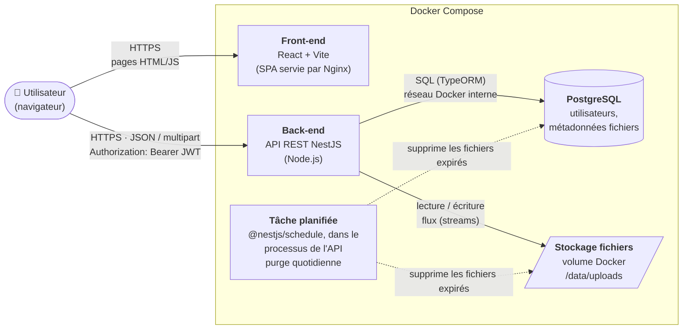
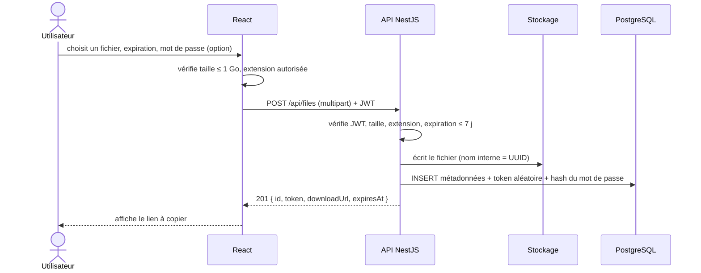
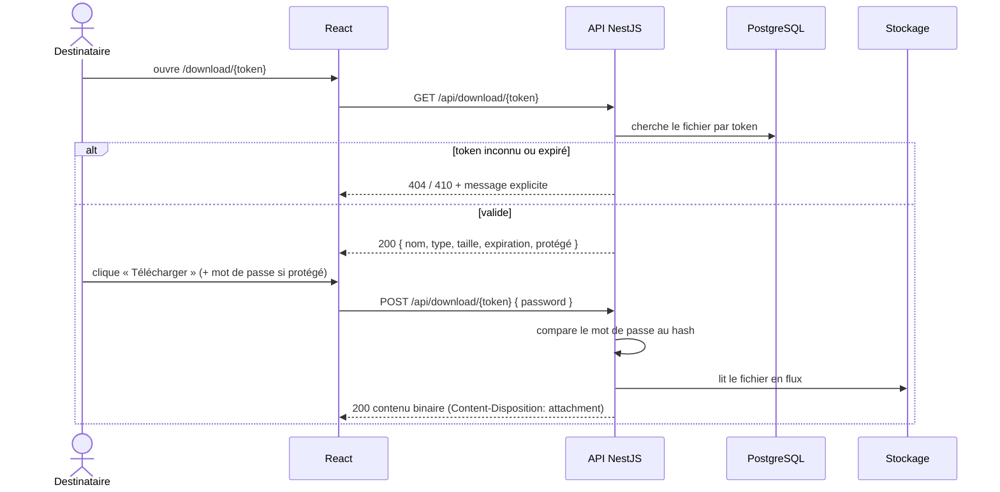

# Architecture de DataShare

## Vue d'ensemble

### Légende

| Symbole | Signification |
|---|---|
| Rectangle | Application ou service |
| Cylindre | Base de données |
| Parallélogramme | Stockage de fichiers |
| Flèche pleine | Requête synchrone |
| Flèche pointillée | Traitement planifié (asynchrone) |
| Cadre « Docker Compose » | Services lancés ensemble, sur un réseau interne |

## Rôle de chaque brique

| Brique | Rôle |
|---|---|
| **Front-end React** | Interface de l'application (maquettes Figma) : envoi, téléchargement, connexion, « Mon espace ». Stocke le JWT et l'envoie dans l'en-tête `Authorization`. Valide les saisies avant envoi. |
| **API NestJS** | Toute la logique métier : authentification, contrôle des droits, validation des entrées (taille, extensions, mots de passe, expiration), génération des tokens de téléchargement. Organisée en modules : `AuthModule`, `UsersModule`, `FilesModule`, `DownloadModule`, `StorageModule`. |
| **PostgreSQL** | Stocke les utilisateurs et les **métadonnées** des fichiers (nom, taille, token, expiration…), pas leur contenu. |
| **Stockage fichiers** | Contenu binaire des fichiers, sur disque (volume Docker). L'accès passe par une interface `StorageService` : on pourra la remplacer par AWS S3 sans toucher au reste du code. |
| **Tâche planifiée** | Exécutée par l'API elle-même (pas de service séparé). Une fois par jour, supprime les fichiers expirés (contenu + métadonnées) — US10. |

## Flux principaux

### Envoi d'un fichier (US01)

### Téléchargement via lien (US02)

## Sécurisation des échanges

- **HTTPS** entre le navigateur et l'application (terminé par un reverse proxy en production ; HTTP en local).
- **JWT** signé (HS256), durée de vie courte, envoyé dans `Authorization: Bearer …`.
- Mots de passe utilisateurs et fichiers **hashés avec bcrypt** (jamais stockés en clair).
- Token de téléchargement **aléatoire et non prévisible** (32 octets, `crypto.randomBytes`), distinct de l'identifiant en base.
- Base de données et stockage **non exposés** hors du réseau Docker : seule l'API y accède.
- **CORS** limité à l'origine du front-end.
