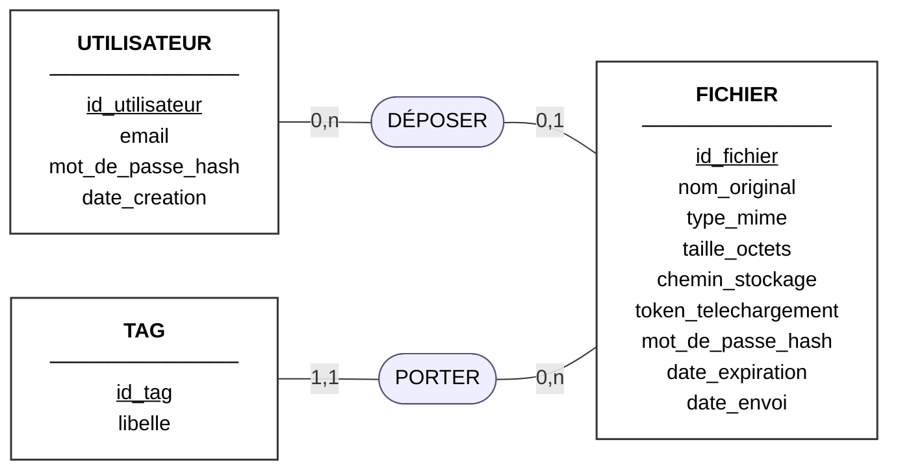
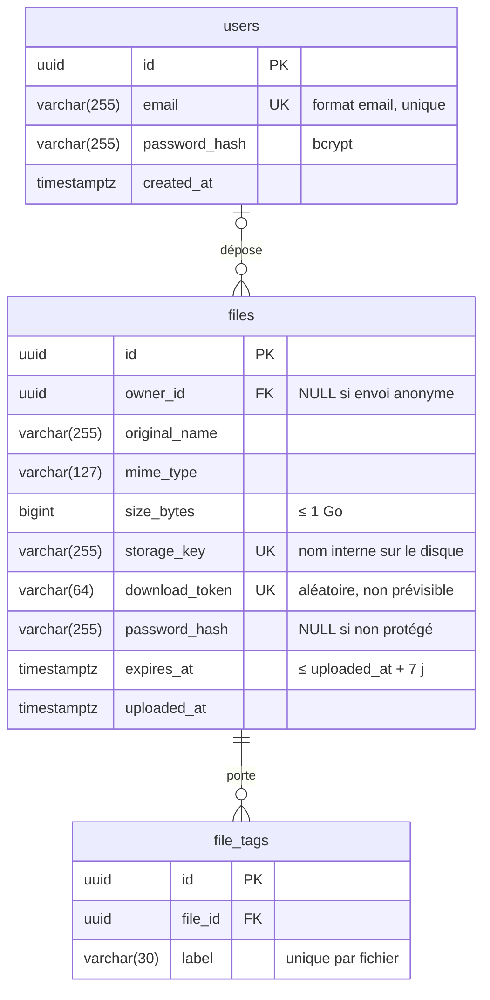

# Modèle de données de DataShare

Le modèle couvre le MVP (US01 à US06) **et** les fonctionnalités optionnelles (US07 à US10) :
les colonnes nécessaires (propriétaire facultatif, mot de passe, tags) sont prévues dès
maintenant pour ne pas devoir migrer le schéma plus tard, même si elles ne sont pas toutes
utilisées dans le MVP.

## MCD (Merise)

Identifiants soulignés. La cardinalité écrite sur un trait appartient à l'entité située de ce côté de l'association.

### Lecture des cardinalités

| Association | Cardinalité | Lecture |
|---|---|---|
| UTILISATEUR — DÉPOSER — FICHIER | **0,n** côté utilisateur | Un utilisateur peut avoir déposé aucun ou plusieurs fichiers. |
| | **0,1** côté fichier | Un fichier est déposé par au plus un utilisateur : **0** pour un envoi anonyme (US07), **1** pour un envoi avec compte (US01). |
| FICHIER — PORTER — TAG | **0,n** côté fichier | Un fichier a de 0 à N tags (US08). |
| | **1,1** côté tag | Un tag appartient à un seul fichier. |

### Choix de modélisation

- **L'état « valide / expiré » n'est pas stocké** : il se calcule (`date_expiration > maintenant`).
  Le stocker créerait une donnée qui peut devenir fausse sans que rien ne la mette à jour.
- **Tags propres à chaque fichier (1,1)** plutôt qu'une liste partagée (N:N) : les specs
  demandent des tags libres, sans suggestion, sans doublon *pour un même fichier*. Le filtrage
  simple par libellé reste possible. Une table partagée serait utile seulement si l'on ajoutait
  des suggestions ou un renommage global (évolution possible).
- **Le token de téléchargement est distinct de l'identifiant** : l'identifiant sert à l'API
  interne (suppression, historique), le token est la seule chose publique, aléatoire et non
  prévisible (US02).
- **Le contenu du fichier n'est pas en base** : seul son chemin sur le stockage y figure.

## MPD (PostgreSQL)

### Contraintes

| Table | Contrainte | Règle métier |
|---|---|---|
| `users` | `UNIQUE (email)` | US03 : email unique |
| `files` | `FOREIGN KEY (owner_id) REFERENCES users(id) ON DELETE CASCADE`, colonne **nullable** | US01 / US07 |
| `files` | `UNIQUE (download_token)` | US02 : un lien = un fichier |
| `files` | `CHECK (size_bytes > 0 AND size_bytes <= 1073741824)` | US01 : 1 Go maximum |
| `files` | `CHECK (expires_at > uploaded_at AND expires_at <= uploaded_at + INTERVAL '7 days')` | US01 / US10 : 7 jours maximum |
| `file_tags` | `FOREIGN KEY (file_id) REFERENCES files(id) ON DELETE CASCADE` | US06 : supprimer un fichier supprime ses tags |
| `file_tags` | `UNIQUE (file_id, label)` | US08 : pas de doublon sur un même fichier |
| `file_tags` | `CHECK (char_length(label) BETWEEN 1 AND 30)` | US08 : 30 caractères maximum |

### Index

| Index | Utilité |
|---|---|
| `files (owner_id, uploaded_at DESC)` | Historique d'un utilisateur, du plus récent au plus ancien (US05) |
| `files (expires_at)` | Purge quotidienne des fichiers expirés (US10) |
| `download_token` et `email` | Déjà indexés par leur contrainte `UNIQUE` |
